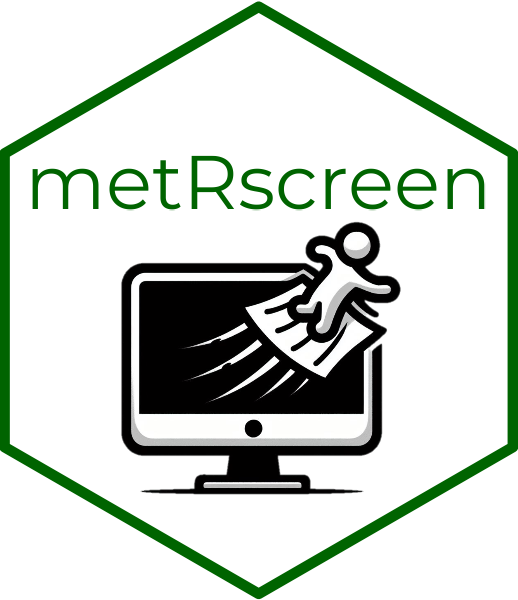

<p align="center">
  
</p>

<div align="center">
 <h1>metRscreen</h1>
</div>

<!-- badges: start -->
[](LICENSE.md)
<!-- badges: end -->

> [!IMPORTANT]
> **A development version with new features and bug fixes is available.** It
> adds full collaborative and double screening, arrow-key navigation, and fixes
> for relative file paths, `.ris` import and R versions before 4.4. See [what's
> new and
> fixed](https://github.com/EIvimeyCook/metRscreen/blob/development/NEWS.md) and
> [how to install it](#installation). **Found a bug? Please try the development
> version first, as it may already be fixed.**

metRscreen is an R package providing a Shiny app for **title and abstract
screening in meta-analyses and systematic reviews**. It presents each reference
one at a time, highlights your keywords in multiple colours so relevant terms
jump out of the abstract, and records an Accept, Reject or No
Decision for every paper, with optional reject reasons and comments.

Screening is the slowest and most error-prone stage of a systematic review.
Hundreds or thousands of abstracts have to be judged consistently against the
same criteria, often across several sessions and sometimes several people.
metRscreen keeps that process in one place: decisions are saved as you go,
rejection reasons are chosen from a list you define rather than typed freehand,
and the whole session state is restored when you reopen the app.

It works best with references exported as a `.csv` from Zotero, but should work
with most references given in `.csv` format — be sure that your data matches the
arguments in the app. **It now also accepts the `.RIS` format from Zotero.**

```r
Title of MS        = "Title"
Authors of MS      = "Author"
Year of MS         = "Publication.Year"
Publishing Journal = "Publication.Title"
Abstract of MS     = "Abstract"
Keywords of MS     = "Manual.Tags"
```

## Features

- **One paper at a time.** Title, authors, year, journal, abstract, and keywords,
  with components you can show or hide to suit your screening style.
- **Multi-colour keyword highlighting.** Pre-load terms per colour so inclusion
  and exclusion signals are visually distinct at a glance.
- **Custom rejection reasons.** Define your own list and select several at once,
  so exclusions are auditable rather than a single undifferentiated "no".
- **Resumable sessions.** An `.rds` file records your decisions and is reloaded
  automatically next time, returning the app to exactly the state you left it in.
- **Zotero `.csv` and `.RIS` support.** Export straight from your reference
  manager.
- **Wildcards in keywords.** `parent*` matches words that continue after the
  stem, such as parental, parenting and parents, but not parent itself. Add
  `parent` as a separate keyword to catch it.
- **Runs locally.** Your reference library never leaves your machine.

## Installation

metRscreen is not on CRAN, but you can install it from GitHub using the
pak package. There are two versions:

**Stable version** (the `master` branch):

```r
install.packages("pak")
pak::pak("EIvimeyCook/metRscreen")
```

The stable version needs R 4.4.0 or later. On older R, use the development
version.

**Development version** (the `development` branch), with the latest features and
bug fixes ([what's new and
fixed](https://github.com/EIvimeyCook/metRscreen/blob/development/NEWS.md)):

```r
pak::pak("EIvimeyCook/metRscreen@development")
```

To check which version you have, run `packageVersion("metRscreen")`: 0.0.1.0
is the stable version and 0.1.1 the development version. To switch between them,
run the other install command.

Then load it with `library(metRscreen)`. Collaborative mode needs the development
version (0.1.1 or later).

## Usage

The only function is `metRscreen()`. The most important argument is
`screen.file`. In the stable version it must be an absolute path, which you can
build with `here::here()` from the here package. A plain relative path such as
`"data/refs.csv"` only works in the development version.

```r
library(metRscreen)
metRscreen(screen.file = "~/Desktop/Examples.csv")
```

Decisions are saved next to your reference file, after every decision, as
`<screen.file>_Screened.csv`: your original columns plus `Screen` (`Accept`,
`Reject`, `No Decision` or `To be screened`), `Reason`, `Comment` and
`Screen.Name`. The session is saved as `<screen.file>_history.rds`.

## Arguments

| Argument | Purpose |
| :------- | :------ |
| `screen.file` | Path to your `.csv` or `.RIS` of references |
| `reject.list` | Character vector of your own rejection reasons |
| `keywords` | Named list of keyword vectors. Allowed names: `green`, `red`, `purple`, `orange`, `blue`. In the app's keyword boxes, separate terms with a comma and a space. |

You can give specific rejection reasons as a vector with `reject.list = c()`, and
select multiple rejection reasons together. You can also specify preloaded
keywords using the `keywords` argument — note that to specify multiple keywords,
include a `","` in addition to the former keyword in the sequence (e.g. `"old,"`,
`"young"`).

```r
metRscreen(
  screen.file = "~/Desktop/Examples.csv",
  reject.list = c("no control", "wrong study system"),
  keywords    = list(green = c("old,", "young"), red = c("parent*"))
)
```

## Resuming a screening session

The `.rds` file that's produced allows for reloading of previous screening
decisions. This will be automatically reloaded the next instance metRscreen is
run and will return screening to the same state — the same reject list, hidden or
showing paper components, and any previous screening decisions.

When a session resumes, the saved keywords replace anything passed to
`keywords`, so change keywords in the app's boxes. A new `reject.list` does
replace the saved one. Font size is not saved.

Keep each reference file in its own folder. The stable version treats any
`.rds` file in that folder as the saved session, so a second project in the
same folder stops the app or makes it fail. This is fixed in the development
version.

## Now in the development branch

The stable version has a basic `collab.names` argument that records a
screener's name against each decision in one shared file. Full collaborative
mode, with separate files per screener and a conflict summary, is in the
development version. Try it out!

Install the development version to use it (see [Installation](#installation)), and
see [NEWS.md](https://github.com/EIvimeyCook/metRscreen/blob/development/NEWS.md) for everything else that is new or fixed.

## Bug reports and contributions

Please file issues and feature requests at
<https://github.com/EIvimeyCook/metRscreen/issues>. Pull requests are welcome.

**Before reporting a bug, please install the development version (see
[Installation](#installation)) and check whether the problem is still there.**
Many bugs are already fixed on the `development` branch; they are listed in
[NEWS.md](https://github.com/EIvimeyCook/metRscreen/blob/development/NEWS.md).
When you file an issue, please include the output of
`packageVersion("metRscreen")` and `sessionInfo()`.

## Related tools

- [**shinyDigitise**](https://github.com/EIvimeyCook/shinyDigitise) — extract data
  from published figures once screening is done
- [**DCQC**](https://github.com/EIvimeyCook/DCQC) — data and code quality control
  checklist for editors and reviewers
- [**READMEBuilder**](https://github.com/EIvimeyCook/READMEBuilder) — document the
  resulting project for archiving

## Citation

If metRscreen helps with your work, please cite it:

> Ivimey-Cook, E. R., & Pick, J. L. (2026). *metRscreen: Title and Abstract
> Screening for Meta-Analyses and Systematic Reviews.* R package.
> <https://github.com/EIvimeyCook/metRscreen>

A machine-readable [`CITATION.cff`](CITATION.cff) is included, so GitHub's
"Cite this repository" button gives formatted APA and BibTeX.

## License

Released under the [MIT License](LICENSE.md).

## AI Declaration

Claude Sonnet 4.6 was used in the latter stages of development.
